# Pgr-Old-Avatar-XML

Phigros 2.0.0 以前商店头像和2026年愚人节头像的 XML 数值与头像图片备份。

这些头像在当前版本中无法正常获取，仅供 root / 虚拟机环境获取与研究使用。

图片素材来源：[Phigros 全头像获取攻略 - 原启Yuanqi](https://www.bilibili.com/opus/1186626870393700370)

## 使用方法

需要 root 或虚拟机环境。

1. 虚拟机开启 root。
2. 使用 `Shizuku` 在 root 下运行。
3. 授权给 MT 管理器。
4. 打开：

```text
/data/user/0/com.PigeonGames.Phigros/shared_prefs/com.PigeonGames.Phigros.v2.playerprefs.xml
```

5. 在 `com.PigeonGames.Phigros.v2.playerprefs.xml` 里填入对应的头像 XML 值。
6. 保存后，移动或删除 MT 管理器自动生成的备份文件即可。

   也可以把`com.PigeonGames.Phigros.v2.playerprefs.xml`文件属性改成只读（但目前无法确定会不会影响上传存档)

## 所需工具获取路径

[MuMu模拟器](https://mumu.163.com/)

[shizuku](https://shizuku.rikka.app/zh-hans/)

[MT管理器](https://mt.cc/)

[TapTap](https://www.taptap.cn/)

[Phigros](https://m.32r.com/app/129142.html)

## 具体操作方法

[视频](https://www.bilibili.com/video/BV1CeaN6TEfF/)

[视频](https://www.bilibili.com/video/BV1fnna66Etg/)

---

## 1. Geopelia 1-by cycats

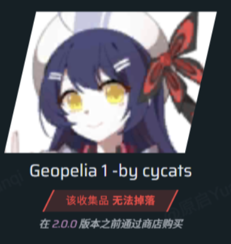

```xml
<string name="1So2ylZIyUcCo97%2FyQod3jTu7NhxaRjtyfwEaq1LsEmU9tSmQDM4TmBQbsJ6x4fF0Inzui7OWnc%3D">xq9bX8oShzg%3D</string>
```

---

## 2. Geopelia 2-by cycats

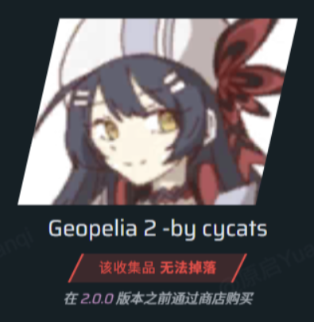

```xml
<string name="1So2ylZIyUcCo97%2FyQod3jTu7NhxaRjt6RP8lLX40zhL5iSKtZRH8P2saSJ9zb9zr7%2BwER6mSoU%3D">xq9bX8oShzg%3D</string>
```

---

## 3. Engine x Start!! extra1-by cycats

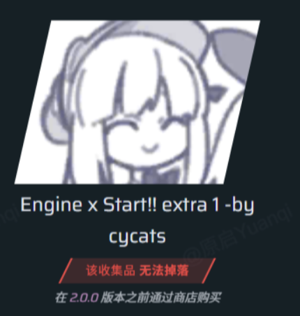

```xml
<string name="1So2ylZIyUcCnXT5mbjGnzoIH%2FVuZroJuQgqaJAGRDCM2Jpkb9WbkkVZHnSHHyOMf%2BSGaXd32HD7okoNwJS5ct3PF6hdNs84aaw3IPsVYXk%3D">xq9bX8oShzg%3D</string>
```

---

## 4. FULi AUTO SHOOTER extra1-by cycats

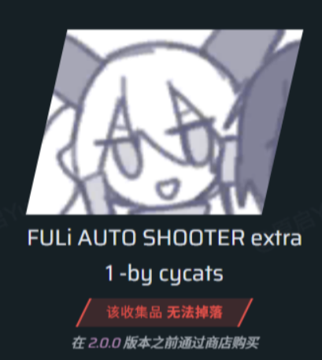

```xml
<string name="1So2ylZIyUekC2MIv2zaV7jyUQYuf%2FFWXdyenhrt0rV0yGR2hsEZBz3VM%2FYbIoEaKvdVOANtjmULV3dvascdVPsTPqa7AhCEd86oq4g9BeR0Gx5YbiXRAQ%3D%3D">xq9bX8oShzg%3D</string>
```

---

## 5. Non-Melodic Ragez extra 1-by cycats

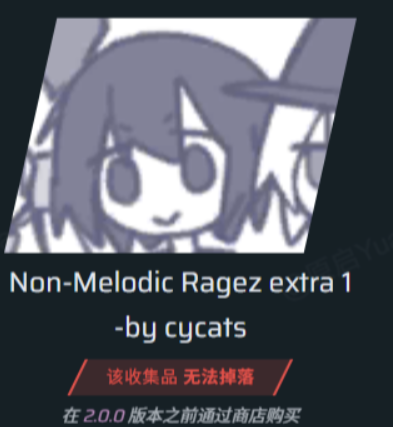

```xml
<string name="1So2ylZIyUfjMztXoUK0uetrYxJKDx8in5fkJ8uMXE8wrPcmFpeMAtyPJISEyanxHvR7RgDpCbWkZfSV0oz0uOD316ZTPBHoX3T2wbd%2FVXf2P5Ks92jC8A%3D%3D">xq9bX8oShzg%3D</string>
```

---

## 6. RIPPER extra 1-by cycats

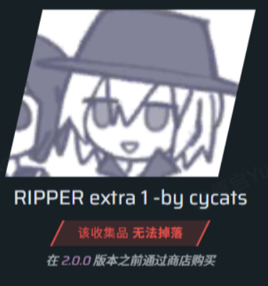

```xml
<string name="1So2ylZIyUe%2B5oDIVwKlDb5wAov9IErvje3iilRqUCuVY%2FD5n7%2FYqvz27RWqKbilTsqxdURV23yriAh9YGq%2FsA%3D%3D">xq9bX8oShzg%3D</string>
```

---

## 7. RIPPER extra 2-by 何呵

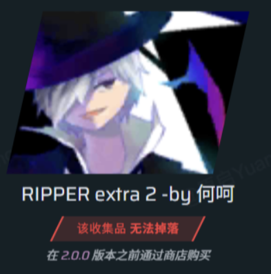

```xml
<string name="1So2ylZIyUe%2B5oDIVwKlDb5wAov9IErvje3iilRqUCsfeOF1yW47ETFmm%2B6TmNzh7yw6a5DOCe0%3D">xq9bX8oShzg%3D</string>
```

---

## 8. Geopelia 3-by 何呵

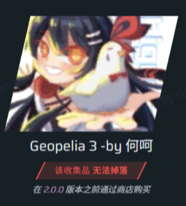

```xml
<string name="1So2ylZIyUcCo97%2FyQod3jTu7NhxaRjtHqh129hoW7OD0tVvEqaVInk76Iup1OEi">xq9bX8oShzg%3D</string>
```

---

## 9. Khronostasis Katharsis

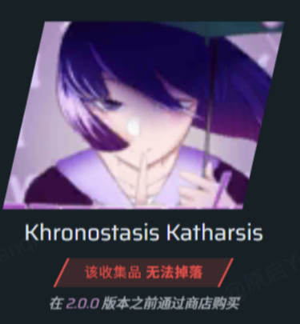

```xml
<string name="1So2ylZIyUc6HVbUUctHgjJpC6VwlqXD0WOqT48UDEQTadurz1Uf%2Fydx0g3FQN5LadZZSZXfJDs%3D">xq9bX8oShzg%3D</string>
```

---

## 10. Sparkle New Life

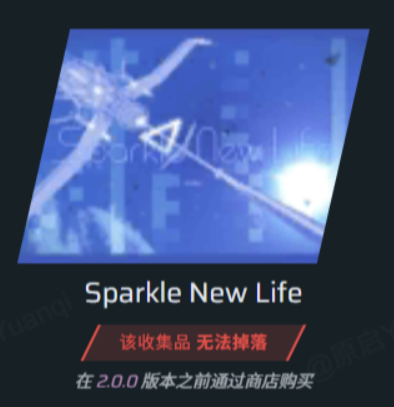

```xml
<string name="1So2ylZIyUeYQfwqFIvJkSS0uMDrICzse20Vmgio9QejTyOuFMSL1UmDg0U%2F11X3">xq9bX8oShzg%3D</string>
```

---

## 11. Find_Me

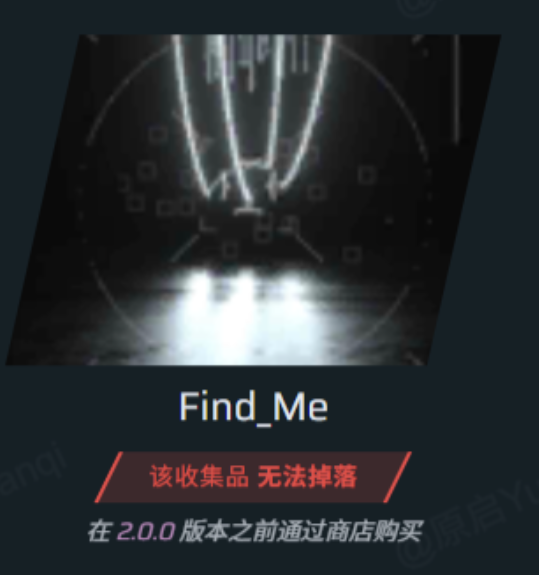

```xml
<string name="1So2ylZIyUdeSwrgH6p%2BuNyww1Oed0Fo">xq9bX8oShzg%3D</string>
```

---

## 12. Sein

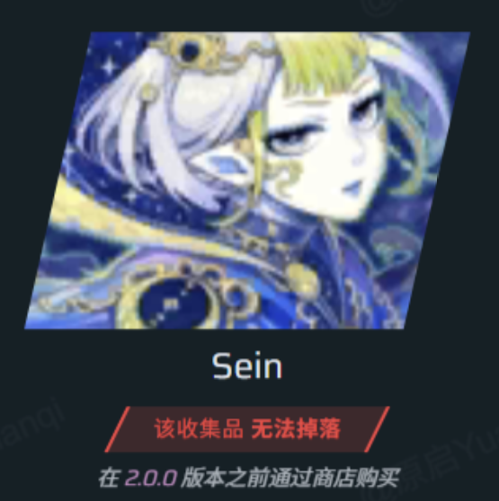

```xml
<string name="1So2ylZIyUffp0qDjw117uvTDWOSwbB9">xq9bX8oShzg%3D</string>
```

---

## 13. 狂喜蘭舞1

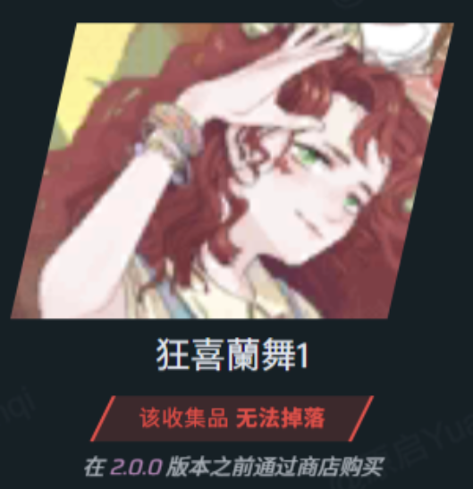

```xml
<string name="1So2ylZIyUeK2VFx1I3cgA6MoG1X%2FK8x">xq9bX8oShzg%3D</string>
```

---

## 14. 狂喜蘭舞2

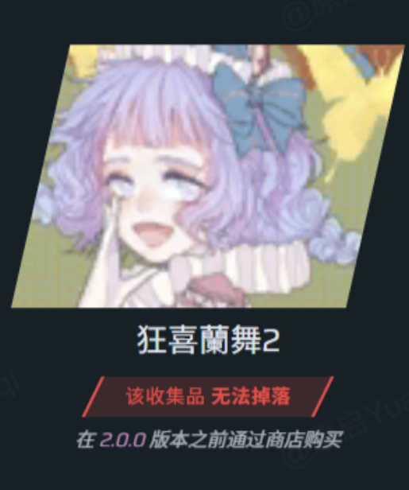

```xml
<string name="1So2ylZIyUeK2VFx1I3cgL6n%2FAxWtlDr">xq9bX8oShzg%3D</string>
```

---

## 15. Marenol extra 1-by 喵n葵

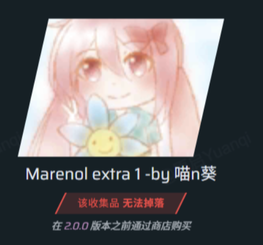

```xml
<string name="1So2ylZIyUdgLKyL3fWbE8HVv0RXhbUd82OZ7CwABGtQehFk9EiDnvU83btvG08pjdQ%2BZyR9yhM%3D">xq9bX8oShzg%3D</string>
```

---

## 16. 云女孩extra 1-by 御坂果子

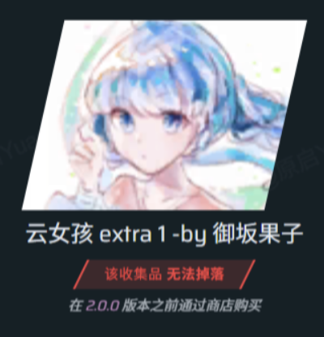

```xml
<string name="1So2ylZIyUdZwjhf6VOPwdzZuXGDNB3hkMW4Eh2bibBiDvBo3NAFYhyZk9Ak%2BSb2qWwu2JYXe6o%3D">xq9bX8oShzg%3D</string>
```

---

## 17. Christmas

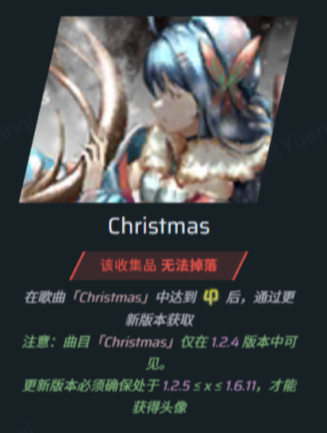

```xml
<string name="1So2ylZIyUdXA2nX%2FPoMLKQn37s%2FKJoiomL2e%2BzRTCkuxaDK7pVxrQ%3D%3D">xq9bX8oShzg%3D</string>
```

---

## 18. Geopelia in WEPLAY-by 海产

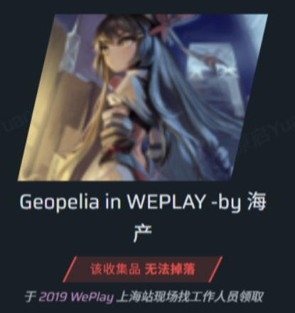

```xml
<string name="4mIcEevygkF9%2F9WIeTdXDegRFvK5ggQb%2F3p2lAtvqKV5MA25ie43aBOA9kHp4Mux">84nt4CDG41fhF5EXHkVpow%3D%3D</string>
```

---

## 19. Snow Desert

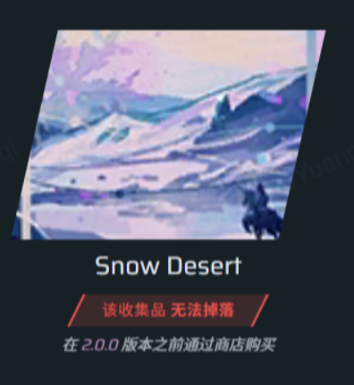

```xml
<string name="1So2ylZIyUcvT2cK1hAc8%2Bdqnnpmk%2BiJ">xq9bX8oShzg%3D</string>
```

---

## 20. Burn

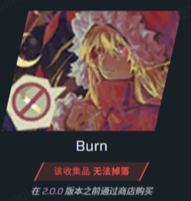

```xml
<string name="1So2ylZIyUfGh8GJ9Gfi8JVZSzk9C0qmu2iyyaeDPnQ%3D">xq9bX8oShzg%3D</string>
```

## 21. Gino-AprilFool

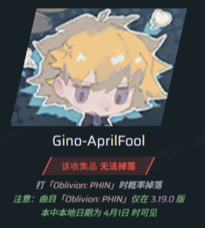

```xml
<string name="b8UKKnNidrS6zp9eA6cRlKvm8%2F0u5rt2bWkU1oB8ss8%3D">84nt4CDG41fhF5EXHkVpow%3D%3D</string>
```

---

## 22. Oblivion:PHIN

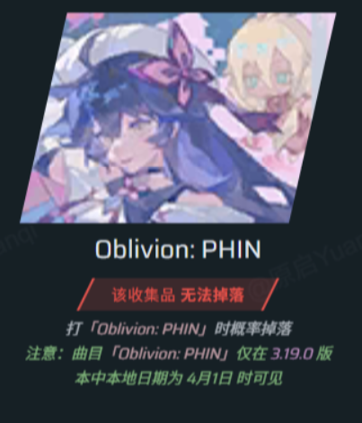

```xml
<string name="p0PsZStllosA%2FOuKCiZISoEOoNFkzxN4Nurdg4YWExw%3D">84nt4CDG41fhF5EXHkVpow%3D%3D</string>
```

---

## 23. 鸠-AprilFool

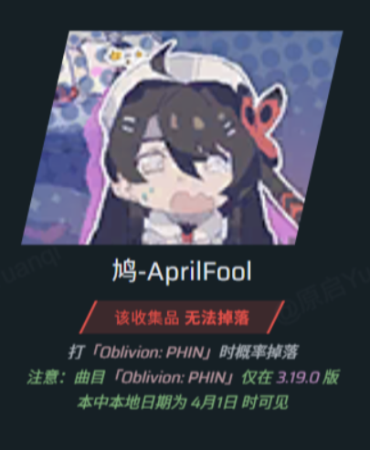

```xml
<string name="F%2BWxa1d3PylrBRCLIEyKORIPowSaM8oka51LnCmf3Ng%3D">84nt4CDG41fhF5EXHkVpow%3D%3D</string>
```

---

## 24. Glaciaxion

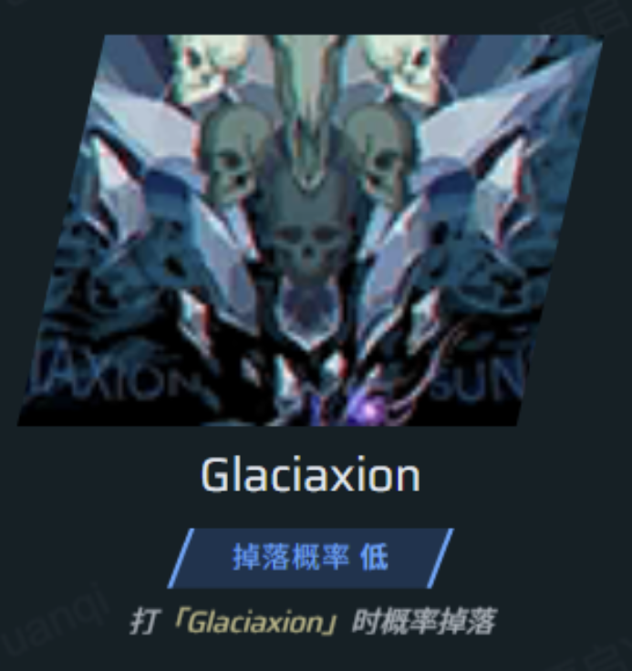

```xml
<string name="1So2ylZIyUdI9WM1XjLa5U%2Fl73EqztHWQ6ZCHD1xlLI%3D">xq9bX8oShzg%3D</string>
```

---

## 25. Eradication Catastrophe


```xml
<string name="lWdeLtx1UO1xi2f2H3v1FJVOfSqbSVzh16gR2hipHmw%3D">84nt4CDG41fhF5EXHkVpow%3D%3D</string>
```

---

## 26.Credits


```xml
<string name="mhQ%2B%2FmIG7pwuAyVgqQy6AA%3D%3D">84nt4CDG41fhF5EXHkVpow%3D%3D</string>
```

---

## 27.Dlyrotz


```xml
<string name="V2k8AIhqLSH10h8dhORmlQ%3D%3D">84nt4CDG41fhF5EXHkVpow%3D%3D</string>
```

---

## 28.Engine x Start!! (melody


```xml
<string name="hzCw2MLldAfJzH1U7RRVWdXp9S%2B2lDl1DbhHBKFFwX6TEbOHOgx9uDPzvc8SqaJn">84nt4CDG41fhF5EXHkVpow%3D%3D</string>
```

---

## 29.光


```xml
<string name="cndeOELSbeDWKyCe9s4gvA%3D%3D">84nt4CDG41fhF5EXHkVpow%3D%3D</string>
```

---

## 30.Winter ↑tcubel↓


```xml
<string name="dtGfvgElRcAEecXkiV3DPCmGqwC2OQagVMhUzcUgdxU%3D">84nt4CDG41fhF5EXHkVpow%3D%3D</string>
```

---

## 31.Cipher:/2 //<|0


```xml
<string name="HDFZTHe97p2ruWH99rzsM84lt8HERQLZ6BtWjZtjyv0%3D">84nt4CDG41fhF5EXHkVpow%3D%3D</string>
```

---

## 32.混乱-Confusion


```xml
<string name="oVuyYylCkmpSkM%2ByYMACtqrILykPz4oDHbCnDSPHwPg%3D">84nt4CDG41fhF5EXHkVpow%3D%3D</string>
```

---

## 33.FULi AUTO SHOOTER


```xml
<string name="N3Xbj8Iv3R9S%2B4LuQHeGiFMLOxtSuL5M%2FUhwjVsxWQk%3D">84nt4CDG41fhF5EXHkVpow%3D%3D</string>
```

---

## 34.HumaN


```xml
<string name="QKqI3e%2Feaw9qt%2BNdWqVvZw%3D%3D">84nt4CDG41fhF5EXHkVpow%3D%3D</string>
```

---

## 35.PRAW


```xml
<string name="Tpla6ZFyR53OMg1SzGmg0g%3D%3D">84nt4CDG41fhF5EXHkVpow%3D%3D</string>
```

---

## 36.Pixel Rebelz1


```xml
<string name="l%2Bvuv%2F2FUqkNcPV4qWWqISTuDC5F7cZYE2d8%2FyR84fA%3D">84nt4CDG41fhF5EXHkVpow%3D%3D</string>
```

---

## 37.Pixel Rebelz2


```xml
<string name="l%2Bvuv%2F2FUqkNcPV4qWWqITHVjNODPe7n2UwFwoK5Uf0%3D">84nt4CDG41fhF5EXHkVpow%3D%3D</string>
```

---

## 38.Pixel Rebelz3


```xml
<string name="l%2Bvuv%2F2FUqkNcPV4qWWqIehWb6D6v29JgVyxu9%2FoFYE%3D">84nt4CDG41fhF5EXHkVpow%3D%3D</string>
```

---

## 39.Cereris1


```xml
<string name="LkMstmA1BqQzj8KhKd1y8A%3D%3D">84nt4CDG41fhF5EXHkVpow%3D%3D</string>
```

---

## 40.Cereris2


```xml
<string name="b2ZH6%2FrQfLVa%2BHnFwgdeSw%3D%3D">84nt4CDG41fhF5EXHkVpow%3D%3D</string>
```

---

## 41.Cereris3


```xml
<string name="uJWpCEdywG6zOOR%2BhhH3lw%3D%3D">84nt4CDG41fhF5EXHkVpow%3D%3D</string>
```

---

## 42.Non-Melodic Ragez (MUGEdit)


```xml
<string name="BP1UQBwiiVbO0JgcDReykhKbl34q7k8qtVN5pwDAVTCOIxsJl%2B6dP1cDzHU8jICh">84nt4CDG41fhF5EXHkVpow%3D%3D</string>
```

---

## 43.Sultan Rage


```xml
<string name="ZTyCYxg9wZ5iiQEuQG%2FbAA%3D%3D">84nt4CDG41fhF5EXHkVpow%3D%3D</string>
```

---

## 44.Class Memories


```xml
<string name="Xx2LB0ua8U0955220xs45IyVOklsKHP18pkMcrPGGq8%3D">84nt4CDG41fhF5EXHkVpow%3D%3D</string>
```

---

## 45.-SURREALISM-


```xml
<string name="PNpLCS%2FzLJIVTvHRCuK18ukvqwORyjeVAdk87%2BIyfs8%3D">84nt4CDG41fhF5EXHkVpow%3D%3D</string>
```

---

## 46.Bonus Time


```xml
<string name="6CzAb1AmMniYgtGV3Wy5TQ%3D%3D">84nt4CDG41fhF5EXHkVpow%3D%3D</string>
```

---

## 47.Energy Synergy Matrix1


```xml
<string name="xSbEsXIXwadtYjJjrmphz5ExoxuesATzAQlY1Yt4UhI%3D">84nt4CDG41fhF5EXHkVpow%3D%3D</string>
```

---

## 48.Energy Synergy Matrix2


```xml
<string name="xSbEsXIXwadtYjJjrmphz33AI0Ee61ngqVmCc3%2FrmPs%3D">84nt4CDG41fhF5EXHkVpow%3D%3D</string>
```

---

## 49.Energy Synergy Matrix3


```xml
<string name="xSbEsXIXwadtYjJjrmphz8ZC2guyaw6QoSiHRyfVVGw%3D">84nt4CDG41fhF5EXHkVpow%3D%3D</string>
```

---

## 50.Doppelganger1


```xml
<string name="MjMx51hYVVa6L9w2ESLnQCx%2B0sirKOaYpMNOEFOmFuE%3D">84nt4CDG41fhF5EXHkVpow%3D%3D</string>
```

---

## 51.Doppelganger2


```xml
<string name="MjMx51hYVVa6L9w2ESLnQKNfOPthf2N1YWBksWyza58%3D">84nt4CDG41fhF5EXHkVpow%3D%3D</string>
```

---

## 52.もペもペ1


```xml
<string name="BkuaKknvKdLW7mzILK2jLpARpIN5pfXAN6NLHvF3iQ8%3D">84nt4CDG41fhF5EXHkVpow%3D%3D</string>
```

---

## 53.もペもペ2


```xml
<string name="BkuaKknvKdLW7mzILK2jLvy%2BHLiSZ7sFaF92kiDNfbg%3D">84nt4CDG41fhF5EXHkVpow%3D%3D</string>
```

---

## 54.MARENOL


```xml
<string name="In5zD0tBUbpm8TWeD5FnWg%3D%3D">84nt4CDG41fhF5EXHkVpow%3D%3D</string>
```

---

## 55.萤火虫の怨1


```xml
<string name="ON5vOG0zm4CFdA6bTmjAgP7%2FFbco3vTtuaGoj4Rpav4%3D">84nt4CDG41fhF5EXHkVpow%3D%3D</string>
```

---

## 56.萤火虫の怨2


```xml
<string name="ON5vOG0zm4CFdA6bTmjAgLRgUjUmvJGrY7iahl28qss%3D">84nt4CDG41fhF5EXHkVpow%3D%3D</string>
```

---

## 57.万吨匿名信


```xml
<string name="Ztd6wFz73WPali3c5Gi6at0I2UDVlyFvCxKzKPkVhGs%3D">84nt4CDG41fhF5EXHkVpow%3D%3D</string>
```

---

## 58.Aphasia


```xml
<string name="1ZDT94FYcQQIvkgYrzvzPQ%3D%3D">84nt4CDG41fhF5EXHkVpow%3D%3D</string>
```

---

## 59.華灯爱1


```xml
<string name="xMLZAi7veIDpvWgIDwIxyQ%3D%3D">84nt4CDG41fhF5EXHkVpow%3D%3D</string>
```

---

## 60.華灯爱2


```xml
<string name="sv2ShQyafcVAZIMYH%2BkCFg%3D%3D">84nt4CDG41fhF5EXHkVpow%3D%3D</string>
```

---

## 61.dB doll


```xml
<string name="m8ORQj0dQWuu0Cg7duXHLw%3D%3D">84nt4CDG41fhF5EXHkVpow%3D%3D</string>
```

---

## 62.Dash


```xml
<string name="TnCmHYi22IMGAMJ1GG9CKA%3D%3D">84nt4CDG41fhF5EXHkVpow%3D%3D</string>
```

---

## 63.Drop It


```xml
<string name="ne5XfJvhCqWdtGp1DwLoEQ%3D%3D">84nt4CDG41fhF5EXHkVpow%3D%3D</string>
```

---

## 64.开心病1


```xml
<string name="x8WmIS%2FIyL0ieYFY51ZPew%3D%3D">84nt4CDG41fhF5EXHkVpow%3D%3D</string>
```

---

## 65.开心病2


```xml
<string name="k%2FCaXJdRclwB6PdGu1d%2BZQ%3D%3D">84nt4CDG41fhF5EXHkVpow%3D%3D</string>
```

---

## 66.Feast远东之宴1


```xml
<string name="V%2FUfVdXuMrRS12dNmdP%2F1QwUw4ki7XV1Hfr4xRnCOrU%3D">84nt4CDG41fhF5EXHkVpow%3D%3D</string>
```

---

## 67.Feast远东之宴2


```xml
<string name="V%2FUfVdXuMrRS12dNmdP%2F1W%2BQuDswGMbblkxp0Scgb6w%3D">84nt4CDG41fhF5EXHkVpow%3D%3D</string>
```

---

## 68.Feast远东之宴3


```xml
<string name="V%2FUfVdXuMrRS12dNmdP%2F1SvyDmmhggIU7owlNSd1qys%3D">84nt4CDG41fhF5EXHkVpow%3D%3D</string>
```

---

## 69.Feast远东之宴4


```xml
<string name="V%2FUfVdXuMrRS12dNmdP%2F1cZMAtvhRyukmFzAb9nrtqA%3D">84nt4CDG41fhF5EXHkVpow%3D%3D</string>
```

---

## 70.Feast远东之宴5


```xml
<string name="V%2FUfVdXuMrRS12dNmdP%2F1ZNCcUvXdwtlUVS0S4IvkzI%3D">84nt4CDG41fhF5EXHkVpow%3D%3D</string>
```

---

## 71.Feast远东之宴6


```xml
<string name="V%2FUfVdXuMrRS12dNmdP%2F1X8ZekmlzMABl4N%2FdJf%2Baj8%3D">84nt4CDG41fhF5EXHkVpow%3D%3D</string>
```

---

## 72.Feast远东之宴7


```xml
<string name="V%2FUfVdXuMrRS12dNmdP%2F1d367yLUI6WsUA%2FQV%2Fp900k%3D">84nt4CDG41fhF5EXHkVpow%3D%3D</string>
```

---

## 73.Feast远东之宴9


```xml
<string name="V%2FUfVdXuMrRS12dNmdP%2F1cwKQjrFP94G6og%2F9UUsNb8%3D">84nt4CDG41fhF5EXHkVpow%3D%3D</string>
```

---

## 74.瓷岁1


```xml
<string name="gA3A1pW9g1OfhKZ8JZlq3g%3D%3D">84nt4CDG41fhF5EXHkVpow%3D%3D</string>
```

---

## 75.瓷岁2


```xml
<string name="ygK6QEnIMaE6xk7WZSHitg%3D%3D">84nt4CDG41fhF5EXHkVpow%3D%3D</string>
```

---

## 76.瓷岁4


```xml
<string name="t%2BFY2E6R2IQpwv%2F8Kx8eCw%3D%3D">84nt4CDG41fhF5EXHkVpow%3D%3D</string>
```

---

## 77.瓷岁6


```xml
<string name="novEm4jKbx9FUrsuGT4e2A%3D%3D">84nt4CDG41fhF5EXHkVpow%3D%3D</string>
```

---

## 78.瓷岁7


```xml
<string name="8by9Hj1Gq%2Bdc%2F7cASPnPQg%3D%3D">84nt4CDG41fhF5EXHkVpow%3D%3D</string>
```

---

## 79.盞茗2


```xml
<string name="yZjGlo1quHXOvyS02yNE8g%3D%3D">84nt4CDG41fhF5EXHkVpow%3D%3D</string>
```

---

## 80.盞茗3


```xml
<string name="SqqRq57uZ0knMPt5TPsW9g%3D%3D">84nt4CDG41fhF5EXHkVpow%3D%3D</string>
```

---

## 81.Feast远东之宴-Special1


```xml
<string name="V%2FUfVdXuMrRS12dNmdP%2F1bLYp9QTyj%2F5I%2BGwcMJ6F%2FU%3D">84nt4CDG41fhF5EXHkVpow%3D%3D</string>
```

---

## 82.Feast远东之宴-Special1


```xml
<string name="V%2FUfVdXuMrRS12dNmdP%2F1XVviLI%2Fk02fiOSP58C0Nhk%3D">84nt4CDG41fhF5EXHkVpow%3D%3D</string>
```

---

## 83.Artificial Existence


```xml
<string name="dKL4vf7Y33TLhT%2FwaXGEmhjkqtZ4yVs84St7iq5F4i8%3D">84nt4CDG41fhF5EXHkVpow%3D%3D</string>
```

---

## 84.Para


```xml
<string name="d18uYDQ0rzOHk7A%2BdAkZCg%3D%3D">84nt4CDG41fhF5EXHkVpow%3D%3D</string>
```

---

## 85.Indelible Scar


```xml
<string name="PAiJDfYyVJxq0Qp26y5dCZ%2FI5Bi5Dl9fxK3NiUai2UA%3D">84nt4CDG41fhF5EXHkVpow%3D%3D</string>
```

---

## 86.Alkaid


```xml
<string name="q%2BP%2FbDZiVx2XEbM4lWginw%3D%3D">84nt4CDG41fhF5EXHkVpow%3D%3D</string>
```

---

## 87.ShineAfter-鸠-普通


```xml
<string name="N%2BcL96S37fLehqD3Q9I0%2BofuzcP2N5pZDbtB4kFzBLw%3D">84nt4CDG41fhF5EXHkVpow%3D%3D</string>
```

---

## 88.ShineAfter-鸠-Special


```xml
<string name="N%2BcL96S37fLehqD3Q9I0%2BnXYpRi9gs60EybtTmoyOrc%3D">84nt4CDG41fhF5EXHkVpow%3D%3D</string>
```

---

## 89.ShineAfter-水青-普通


```xml
<string name="ppWD47QTHWGWLKAFCEY7IcS46ixehJz%2BsL88OK9l9EE%3D">84nt4CDG41fhF5EXHkVpow%3D%3D</string>
```

---

## 90.ShineAfter-水青-Special1


```xml
<string name="ppWD47QTHWGWLKAFCEY7IYJWWSZX2%2Bt9Zk%2BGWpoF3dQ%3D">84nt4CDG41fhF5EXHkVpow%3D%3D</string>
```

---

## 91.ShineAfter-水青-Special2


```xml
<string name="ppWD47QTHWGWLKAFCEY7IS1q0MyxJRps8dU2TOb0hl0%3D">84nt4CDG41fhF5EXHkVpow%3D%3D</string>
```

---

## 92.ShineAfter-鸠和水青-Special


```xml
<string name="N%2BcL96S37fLehqD3Q9I0%2BrdXiQzSpqZ4SQYgjbFfaYWY0%2FNQ%2FkQQsP7WBFcHsiX7">84nt4CDG41fhF5EXHkVpow%3D%3D</string>
```

---

## 93.鸠-一周年相聚


```xml
<string name="az5z8DzkR52F51PVNoQ4tbi9qeIBEYBgODZBKh231dA%3D">84nt4CDG41fhF5EXHkVpow%3D%3D</string>
```

---

## 94.水青-—周年相聚


```xml
<string name="tbQI5XmF4MxMBdRNaUYJQm%2FTOW%2FG%2B9kYNK9trXQUmwk%3D">84nt4CDG41fhF5EXHkVpow%3D%3D</string>
```

---

## 免责声明

本仓库仅用于对 Phigros 已有头像/曲绘获取与技术交流，**!!请勿!!**用于商业用途或破坏游戏公平性。本仓库不涉及更改分数、RKS、暴力解析存档等行为。请自行承担使用 root、虚拟机、文件修改等操作带来的风险。若发现他人侵权行为或页面出现bug 请联系[我的 B 站主页](https://space.bilibili.com/626182490)/[另一个共同创作者的 B 站主页](https://space.bilibili.com/1029180669)，我们会尽快处理。
